# Practical 01: Network Discovery and Configuration Assessment

## 1. Introduction

Network discovery is the process of identifying devices, network interfaces, IP addresses, and communication paths within a network.

The purpose of this practical was to inspect the network configuration of a Windows host, a Kali Linux virtual machine, and an Ubuntu virtual machine.

The exercise was conducted using Oracle VirtualBox. Both Linux virtual machines were configured with two network adapters: NAT for internet access and an Internal Network for communication within the isolated lab environment.

## 2. Objectives

The objectives of this practical were to:

- Identify network interfaces and their IP addresses.
- Examine subnet masks and default gateways.
- Understand the differences between NAT and Internal Network configurations.
- Inspect routing tables.
- Test connectivity between systems.
- Examine neighbour discovery and IP-to-MAC address mappings.
- Document the findings in a technical report.

## 3. Lab Environment

| System | Operating System | Role |
|---|---|---|
| Host machine | Windows | Physical host |
| Virtual machine 1 | Kali Linux Rolling | Security testing machine |
| Virtual machine 2 | Ubuntu 25.10 | Linux endpoint |

**Virtualization platform:** Oracle VirtualBox

**Network configuration:**
- Adapter 1: NAT
- Adapter 2: Internal Network
- Internal network name: `cyberlab`

## 4. Network Discovery — Windows Host

### 4.1 Identify network configuration

**Command executed:**

```cmd
ipconfig /all
```
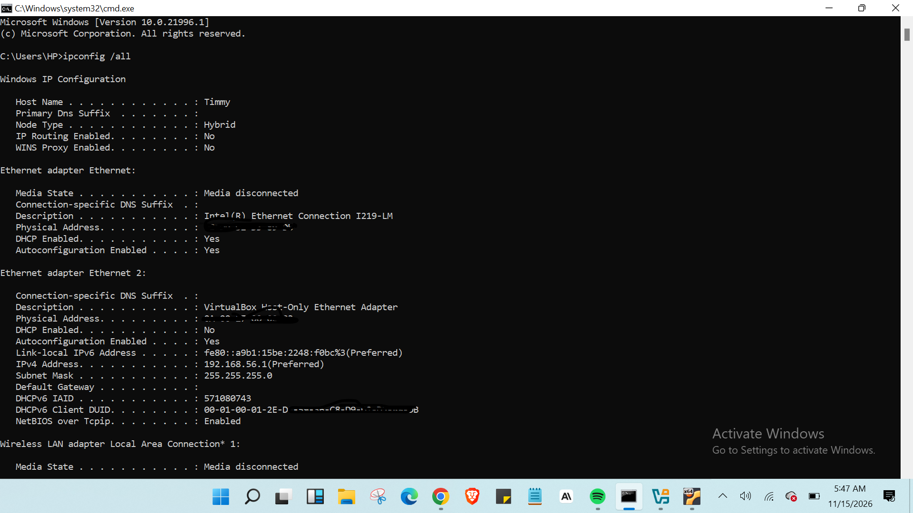
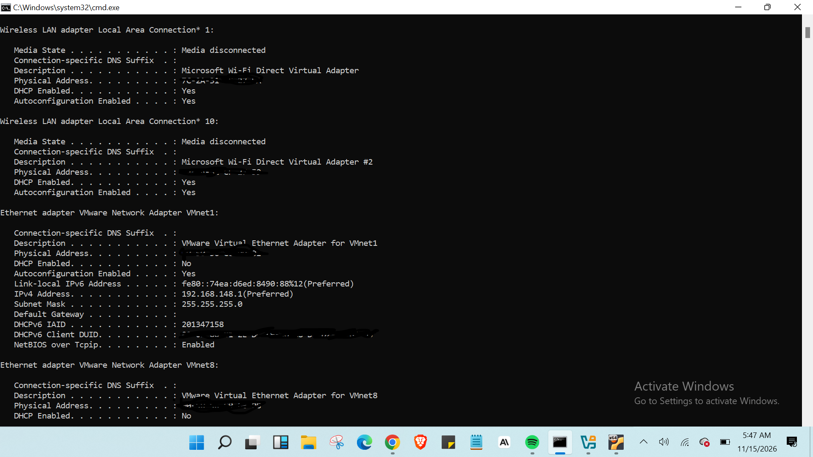
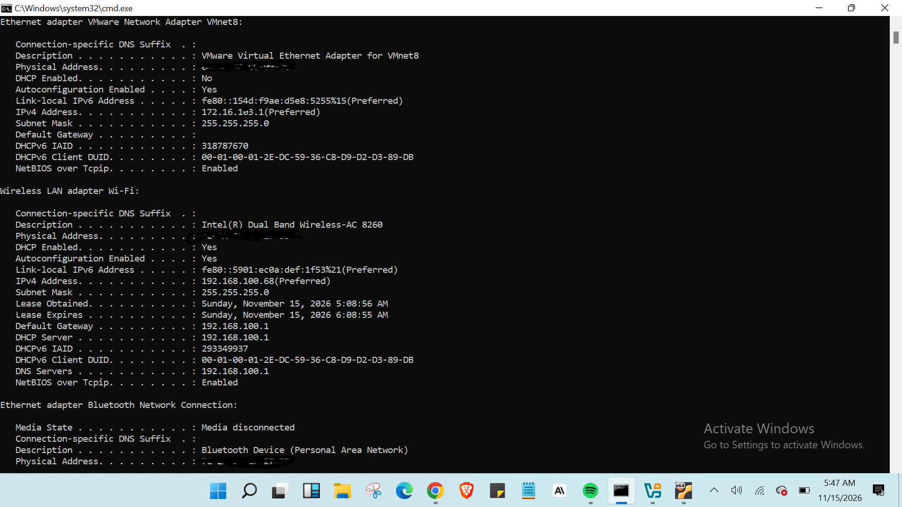
**Purpose:**

This command displays detailed network configuration information, including network adapters, IPv4 addresses, subnet masks, default gateways, DHCP settings, DNS servers, and MAC addresses.

**Key observations:**

- The active physical connection was Wi-Fi.
- The computer received its IPv4 configuration through DHCP.
- The Wi-Fi interface had an IPv4 address of `192.168.100.68` during the inspection.
- The subnet mask was `255.255.255.0`.
- The default gateway was `192.168.100.1`.

The computer also displayed virtual network adapters associated with VirtualBox and VMware.

**Learning outcome:**

I learned how to identify active network interfaces and distinguish physical network connections from virtual network adapters.

### 4.2 Test network connectivity

The following commands were executed:

```cmd
ping 127.0.0.1
ping 192.168.100.1
ping 8.8.8.8
```

**Purpose:**

- `127.0.0.1`: Tests the local TCP/IP stack.
- `192.168.100.1`: Tests connectivity to the router used during that inspection.
- `8.8.8.8`: Tests external IP connectivity.

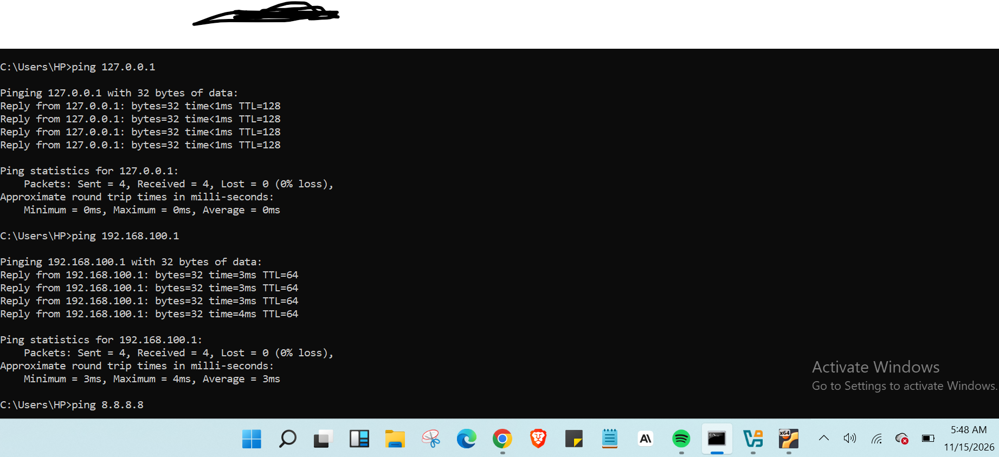
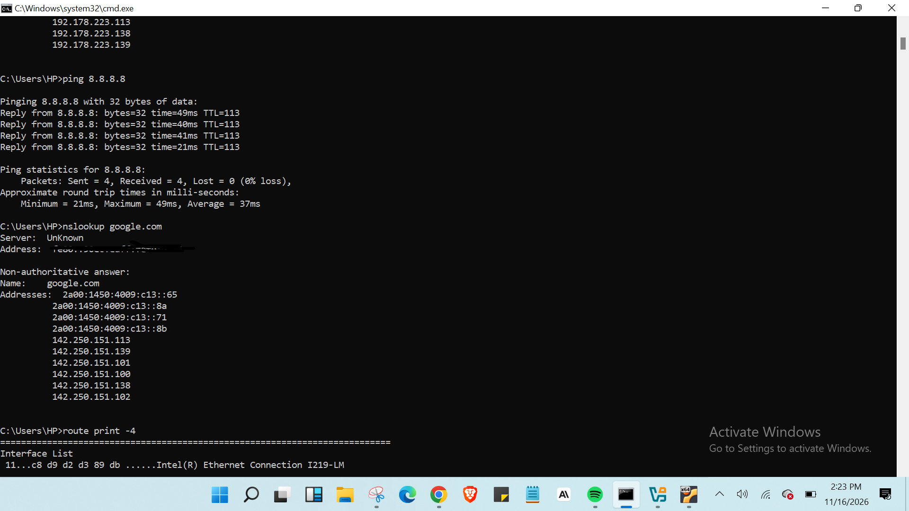
**Results:**

All three tests returned successful replies with zero packet loss.

### 4.3 Test DNS resolution

**Command executed:**

```cmd
nslookup google.com
```

**Purpose:**

This command checks whether a DNS server can resolve a domain name into its corresponding IP address.

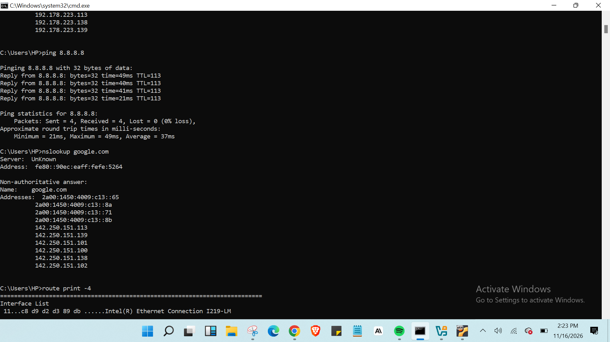

**Observation:**

The query successfully returned IPv4 and IPv6 addresses for `google.com`.

**Learning outcome:**

I confirmed that DNS resolution was working during the practical.

### 4.4 Examine the IPv4 routing table

**Command executed:**

```cmd
route print -4
```

**Purpose:**

This command displays the Windows IPv4 routing table, including destination networks, gateways, interfaces, and routing metrics.

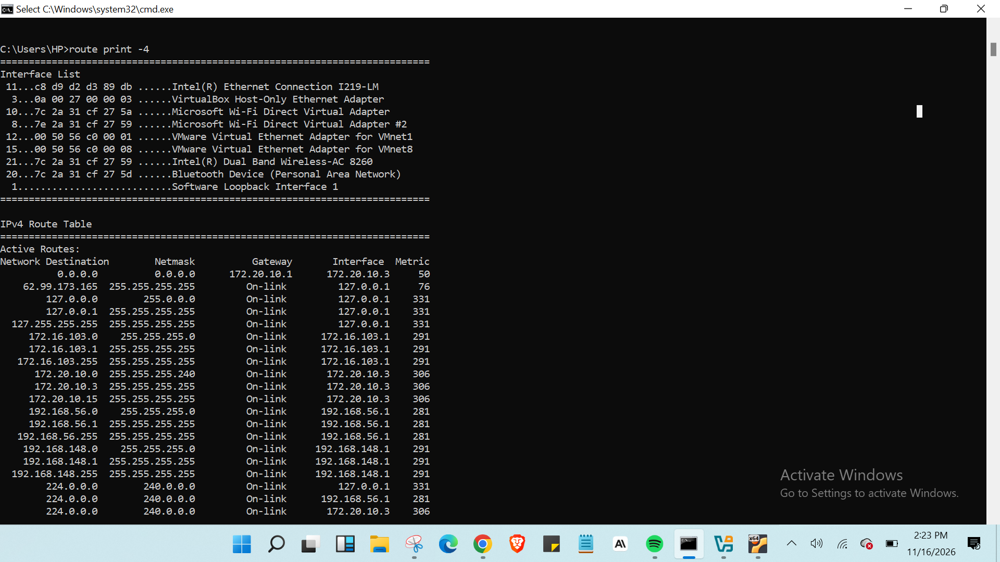
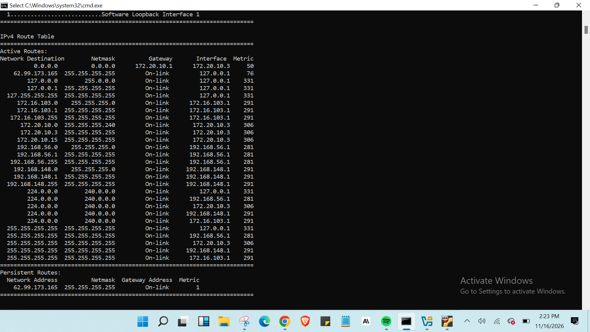

**Observation:**

The routing table displayed routes associated with the physical Wi-Fi connection and several virtual network adapters.

**Learning outcome:**

I learned how to inspect routing information and identify the default route used for traffic leaving a system.

## 5. Network Discovery — Kali Linux

### 5.1 Identify network interfaces

**Command executed:**

```bash
ip a
```

**Purpose:**

Displays available network interfaces, their operational states, MAC addresses, and assigned IP addresses.

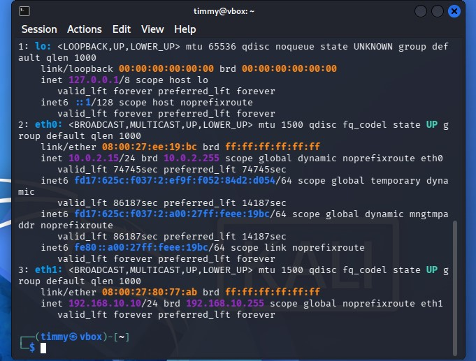

**Observed interfaces:**

| Interface | IPv4 Address | Purpose |
|---|---|---|
| `lo` | `127.0.0.1` | Loopback |
| `eth0` | `10.0.2.15/24` | NAT |
| `eth1` | `192.168.10.10/24` | Internal Network |

### 5.2 Examine routing information

**Command executed:**

```bash
ip route
```

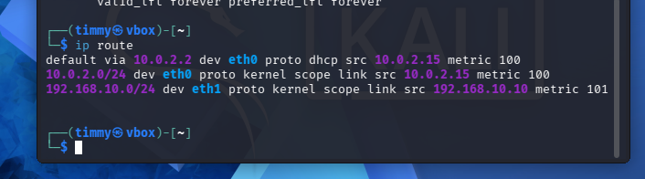

**Observed routing information:**

- Default gateway: `10.0.2.2` through `eth0`.
- NAT network: `10.0.2.0/24`.
- Internal network: `192.168.10.0/24` through `eth1`.

### 5.3 Test internet connectivity

**Command executed:**

```bash
ping -c 4 8.8.8.8
```

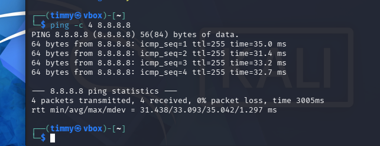

**Result:**

Four packets were transmitted and received, with zero packet loss.

**Learning outcome:**

I verified that Kali Linux could reach an external IP address through its NAT interface.

## 6. Network Discovery — Ubuntu

### 6.1 Identify network interfaces

**Command executed:**

```bash
ip a
```

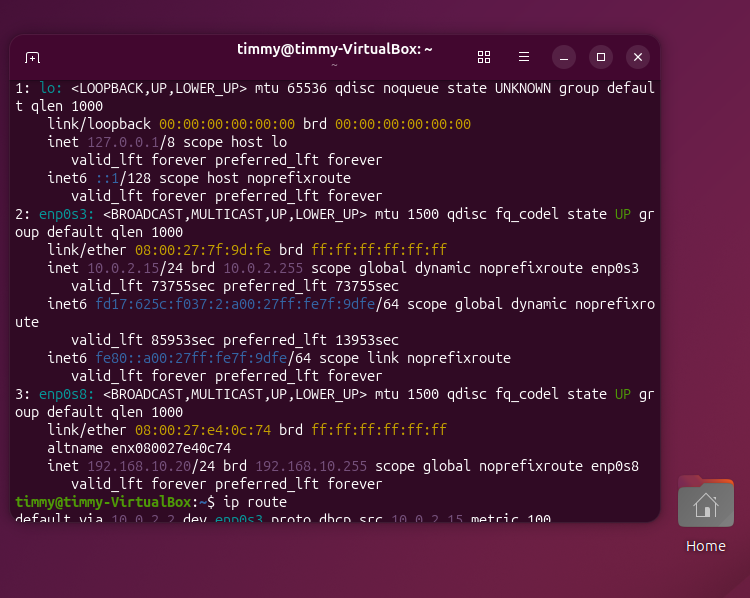

**Observed interfaces:**

| Interface | IPv4 Address | Purpose |
|---|---|---|
| `lo` | `127.0.0.1` | Loopback |
| `enp0s3` | `10.0.2.15/24` | NAT |
| `enp0s8` | `192.168.10.20/24` | Internal Network |

### 6.2 Examine routing information

**Command executed:**

```bash
ip route
```

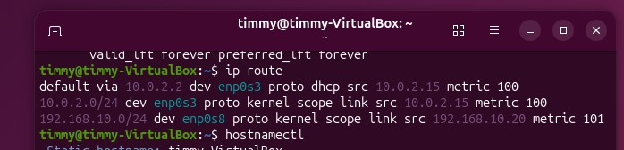

**Observed routing information:**

- Default gateway: `10.0.2.2` through `enp0s3`.
- NAT network: `10.0.2.0/24`.
- Internal network: `192.168.10.0/24` through `enp0s8`.

### 6.3 Test internet connectivity

**Command executed:**

```bash
ping -c 4 8.8.8.8
```

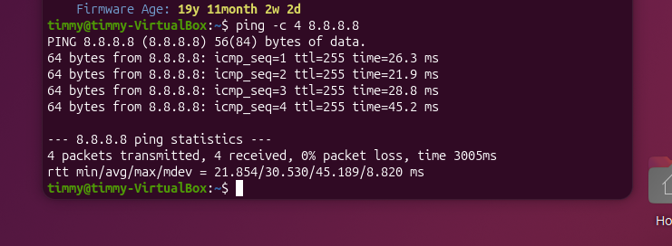

**Result:**

Four packets were transmitted and received, with zero packet loss.

**Learning outcome:**

I verified that Ubuntu could reach an external IP address through its NAT interface.

## 7. VirtualBox Network Configuration

Both virtual machines were inspected through VirtualBox network settings.


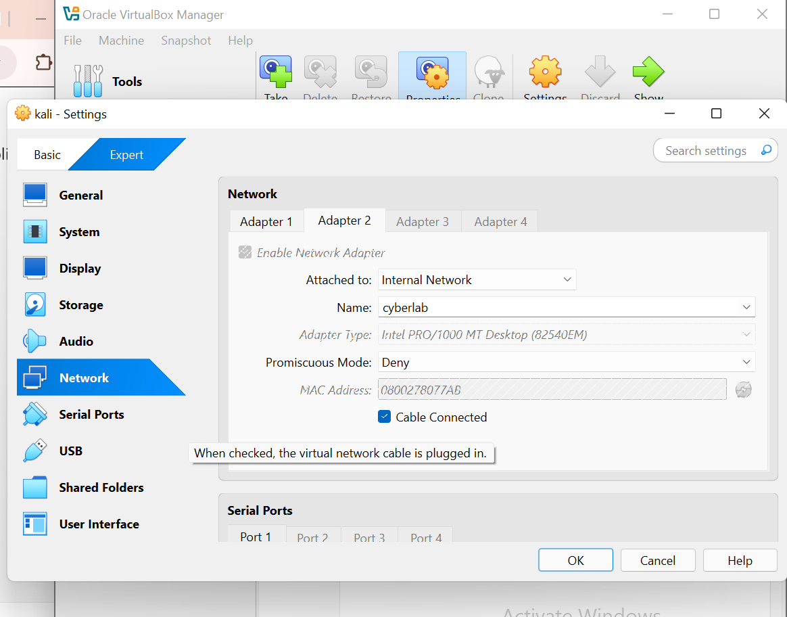
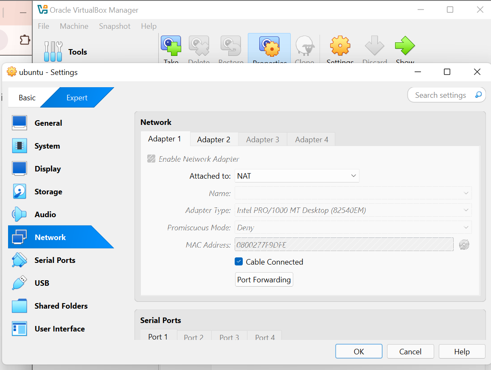
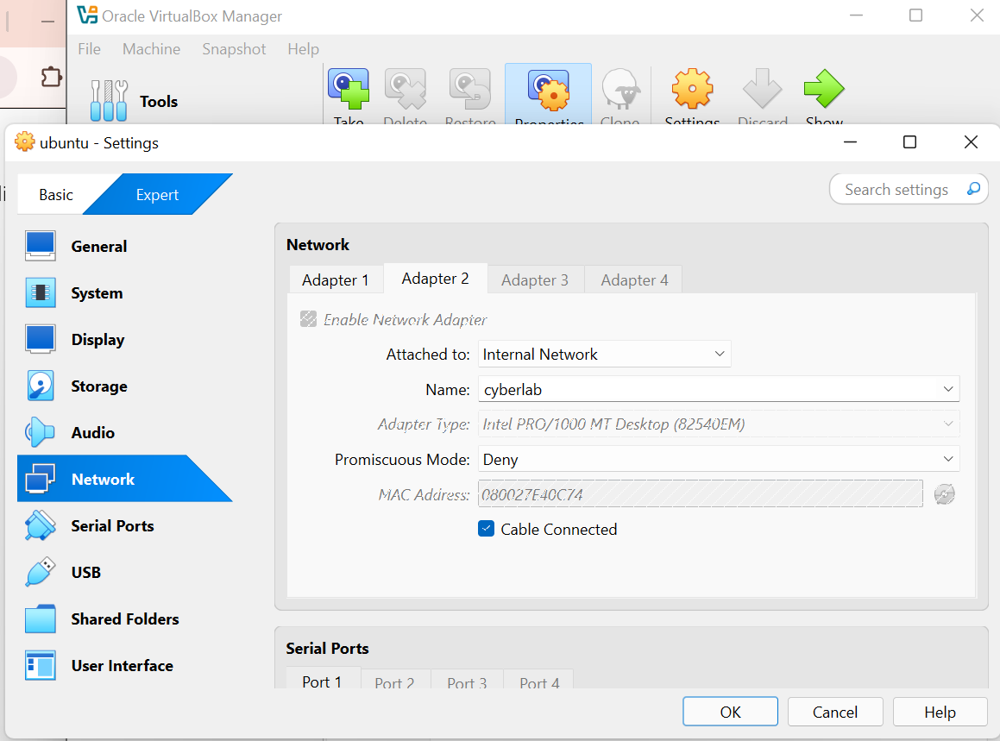

The following configuration was identified:

| Machine | Adapter 1 | Adapter 2 |
|---|---|---|
| Kali Linux | NAT | Internal Network: cyberlab |
| Ubuntu | NAT | Internal Network: cyberlab |

**Key observation:**

Both machines used separate NAT environments for internet access while sharing the same Internal Network for direct communication.

This explains why both machines could use `10.0.2.15` on their respective NAT interfaces without an IP address conflict.

## 8. Connectivity Testing Between Virtual Machines

### 8.1 Kali to Ubuntu

**Command executed on Kali:**

```bash
ping -c 4 192.168.10.20
```
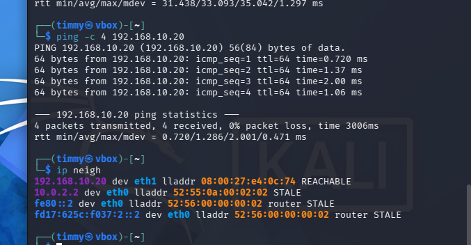

**Result:**

- Packets transmitted: 4
- Packets received: 4
- Packet loss: 0%

Kali successfully communicated with Ubuntu over the `cyberlab` network.

### 8.2 Ubuntu to Kali

**Command executed on Ubuntu:**

```bash
ping -c 4 192.168.10.10
```
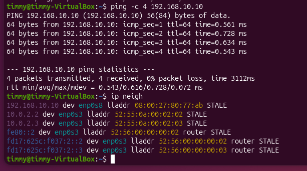

**Result:**

- Packets transmitted: 4
- Packets received: 4
- Packet loss: 0%

Ubuntu successfully communicated with Kali over the same internal network.

### 8.3 Neighbour discovery

**Command executed on both machines:**

```bash
ip neigh
```
*Note:* The pictures are up above.

**Purpose:**

Displays the Linux neighbour table, including IP-to-MAC address mappings learned through local network communication.

**Observation:**

Both machines displayed neighbour entries corresponding to the other virtual machine's internal network address and MAC address.

**Learning outcome:**

I learned how systems discover the link-layer addresses associated with IPv4 neighbours on a local network.

## 9. Key Findings

The practical established that:

1. The Windows host had working local, gateway, external IP, and DNS connectivity during the inspection.
2. Both Linux virtual machines had two active network interfaces.
3. Both VMs successfully accessed the internet through NAT.
4. Both VMs shared the VirtualBox Internal Network named `cyberlab`.
5. Kali and Ubuntu successfully communicated in both directions.
6. Neighbour discovery displayed the corresponding IP-to-MAC mappings.

## 10. Challenges and Observations

One important observation was that Kali and Ubuntu both had the same primary NAT IPv4 address: `10.0.2.15`.

This did not create a conflict because each VM was attached to its own isolated VirtualBox NAT environment.

Another observation was that the Windows host's network configuration could change when connecting to a different Wi-Fi network. Therefore, network details were recorded as observations from the time of testing rather than treated as permanent settings.

## 11. Conclusion

This practical provided hands-on experience in network discovery, IP addressing, routing, virtual network configuration, and connectivity verification.

I gained practical experience using Windows and Linux networking commands and learned how VirtualBox NAT and Internal Network configurations can be used together to build an isolated cybersecurity lab.

The exercise established a foundation for future practical work involving network traffic analysis, vulnerability assessment, security monitoring, and incident response.