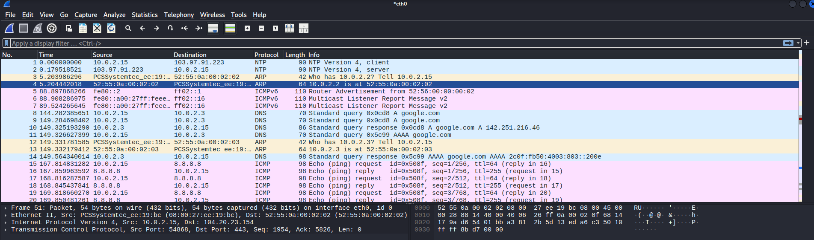
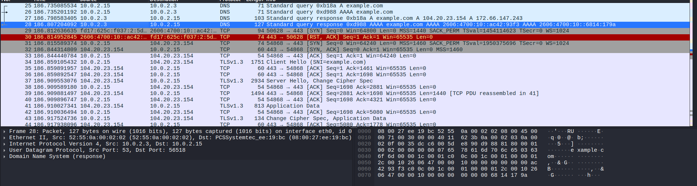
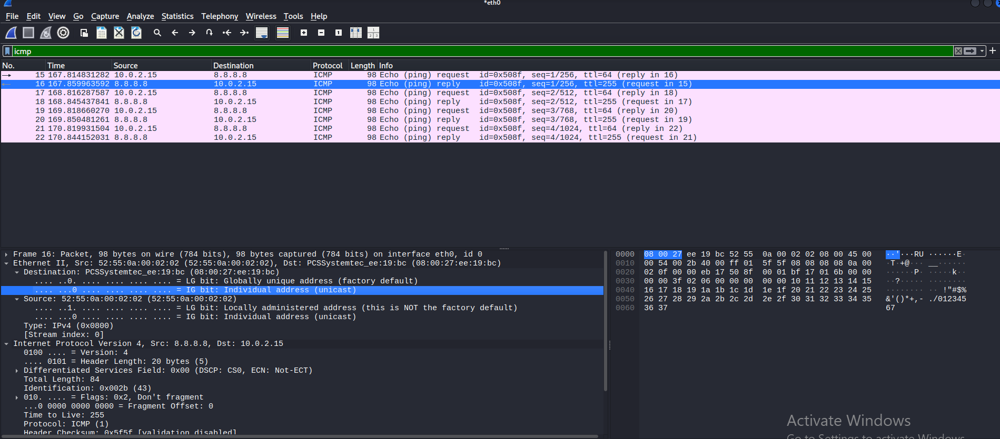
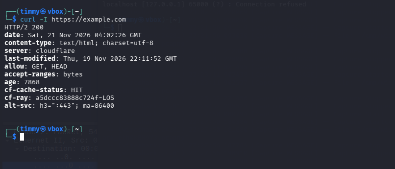
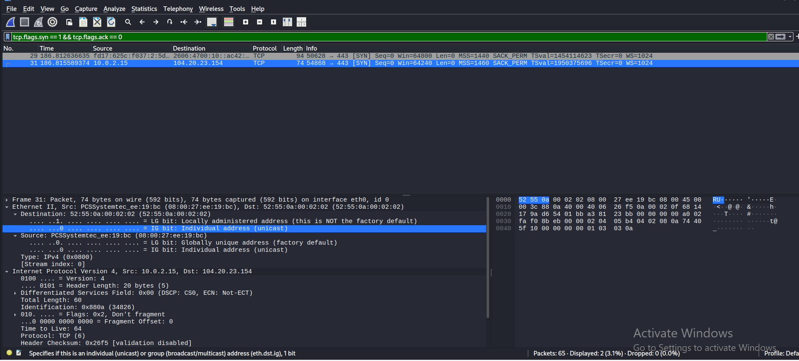
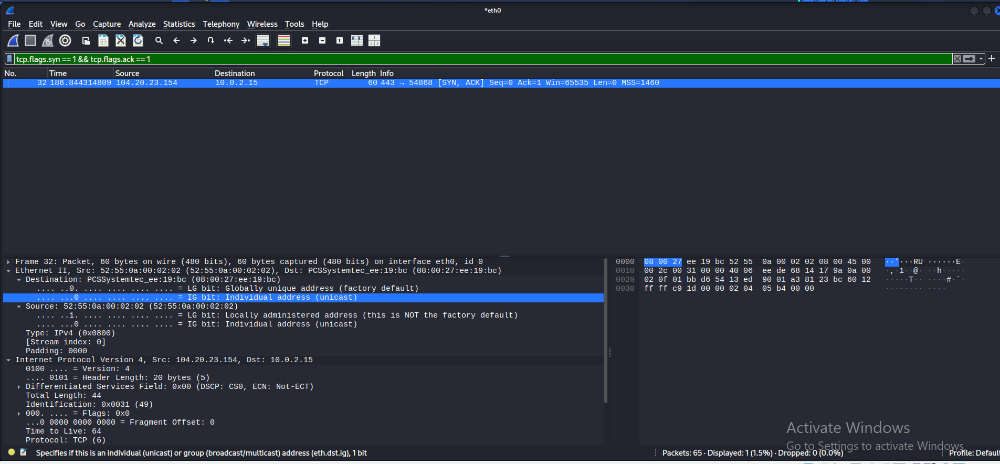
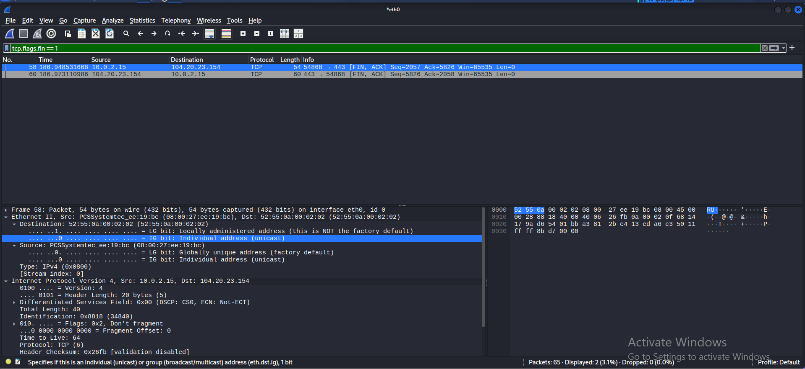
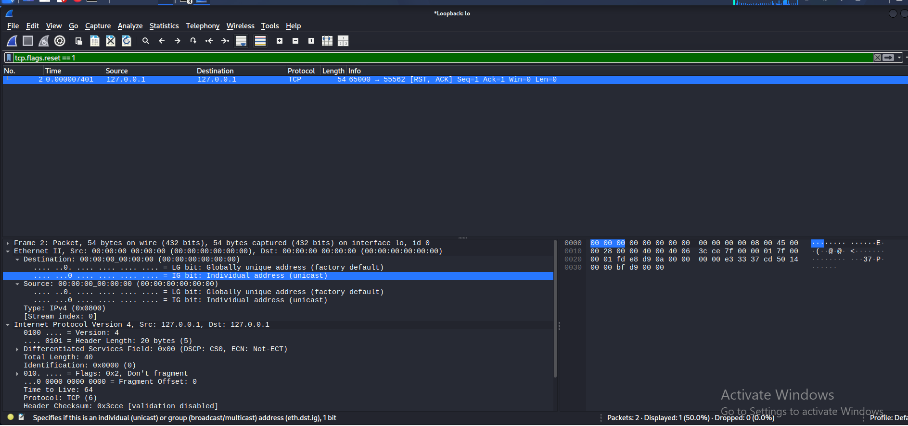

# Project 002: OSI and TCP/IP Models — Wireshark Traffic Analysis

## 1. Project Overview

This project demonstrates practical network traffic analysis using Wireshark on Kali Linux.

The objective was to understand how network protocols operate, identify communication patterns, inspect packet headers, and observe TCP connection establishment and termination.

## 2. Lab Environment

| Component | Configuration |
|---|---|
| Operating System | Kali Linux |
| Virtualization | Oracle VirtualBox |
| Capture Tool | Wireshark |
| Network Interface | eth0 (NAT) |
| Kali IPv4 Address | 10.0.2.15 |
| NAT Gateway | 10.0.2.2 |
| Internal Interface | eth1 |
| Internal Network | cyberlab |

## 3. DNS Traffic Analysis

### Objective
Understand how DNS resolves domain names into IP addresses.

### Commands Used

```bash
nslookup google.com
```

```bash
curl -I https://example.com
```

### Wireshark Display Filter

```text
dns
```





### Observations

- Captured DNS queries and responses.
- Observed queries for google.com and example.com.
- Identified DNS A-record queries.
- Observed DNS communication between Kali (10.0.2.15) and the DNS server (10.0.2.3).
- Observed an IPv4 address returned in a DNS response.

### Security Relevance

DNS traffic can assist security analysts in identifying unusual domain lookups, suspicious destinations, and potential malware command-and-control activity.

## 4. ICMP Traffic Analysis

### Objective
Understand how ICMP supports network connectivity testing.

### Command Used

```bash
ping -c 4 8.8.8.8
```
.PNG)
### Wireshark Display Filter

```text
icmp
```

### Observations

- Captured ICMP Echo Requests.
- Captured corresponding Echo Replies.
- Observed communication between 10.0.2.15 and 8.8.8.8.
- Identified ICMP Type 8 (Echo Request).
- Identified ICMP Type 0 (Echo Reply).

### Security Relevance

ICMP traffic is useful for network troubleshooting and can also help analysts investigate reconnaissance and unusual network communication.

## 5. TCP Three-Way Handshake Analysis

### Objective
Understand how TCP establishes a connection between a client and a server.

### Command Used

```bash
curl -I https://example.com
```

### Wireshark Display Filters

Initial SYN:

```text
tcp.flags.syn == 1 && tcp.flags.ack == 0
```



SYN-ACK:

```text
tcp.flags.syn == 1 && tcp.flags.ack == 1
```


### Observations

Identified the following handshake:

| Packet | Source | Destination | TCP Flags |
|---|---|---|---|
| 31 | 10.0.2.15:54868 | 104.20.23.154:443 | SYN |
| 32 | 104.20.23.154:443 | 10.0.2.15:54868 | SYN, ACK |
| 33 | 10.0.2.15:54868 | 104.20.23.154:443 | ACK |

The handshake demonstrates successful TCP connection establishment.

Port 443 is commonly associated with HTTPS.

## 6. TCP Connection Termination — FIN

### Objective
Observe graceful TCP connection termination.

### Wireshark Display Filter

```text
tcp.flags.fin == 1
```


### Observations

Captured FIN, ACK packets in both directions:

| Packet | Source | Destination | Flags |
|---|---|---|---|
| 58 | 10.0.2.15:54868 | 104.20.23.154:443 | FIN, ACK |
| 60 | 104.20.23.154:443 | 10.0.2.15:54868 | FIN, ACK |

These packets demonstrate that both endpoints participated in an orderly TCP shutdown.

## 7. TCP Connection Reset — RST

### Objective
Understand how TCP connections can be abruptly reset.

### Wireshark Display Filter

```text
tcp.flags.reset == 1
```


### First Observation

Observed an RST, ACK response in an IPv6 TCP connection attempt involving port 443.

### Controlled Local RST Test

Command used:

```bash
nc -vz -w 3 127.0.0.1 65000
```

The test attempted to connect to a local TCP port where no listening service was expected.

### Observations

- Captured a TCP RST, ACK packet.
- Source and destination IP: 127.0.0.1.
- Source port: 65000.
- Destination port: 55562.
- Interface: loopback (lo).

The connection refusal demonstrated how a closed TCP port can generate a reset response.

## 8. Key Wireshark Filters

| Purpose | Display Filter |
|---|---|
| DNS traffic | `dns` |
| ICMP traffic | `icmp` |
| All TCP traffic | `tcp` |
| SYN packets | `tcp.flags.syn == 1 && tcp.flags.ack == 0` |
| SYN-ACK packets | `tcp.flags.syn == 1 && tcp.flags.ack == 1` |
| FIN packets | `tcp.flags.fin == 1` |
| RST packets | `tcp.flags.reset == 1` |

## 9. Key Learning Outcomes

Through this practical, I gained experience in:

- Capturing and filtering network traffic using Wireshark.
- Understanding DNS queries and responses.
- Identifying ICMP Echo Requests and Echo Replies.
- Analysing TCP connection establishment.
- Recognising TCP FIN and RST flags.
- Inspecting packet headers and network addresses.
- Understanding how packet-level evidence supports network troubleshooting and security investigations.

## 10. Conclusion

This practical strengthened my understanding of network communication and protocol behaviour.

It provided hands-on experience analysing DNS, ICMP and TCP traffic and interpreting packet-level evidence using Wireshark.

These skills form part of the foundation required for network security monitoring, SOC operations and incident investigation.
